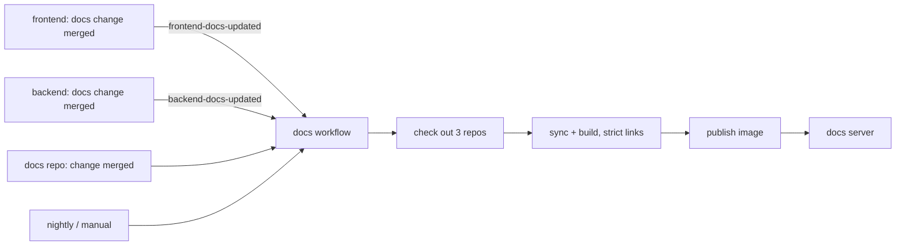

# How docs are synced

## Principles

1. **One source per document.** User guides are written in the docs repository (`lab-mango-docs`,
   `docs/guides/`). Engineering docs stay in the repository whose code they describe and are reviewed in the same
   pull request as the code.
2. **Nobody edits the copies.** `docs/developer/frontend/` and `docs/developer/backend/` are generated and
   gitignored. Every synced page has an **Edit this page** link and a note that point to its source file.
3. **Every merged change publishes itself.** A docs change in any of the three repositories rebuilds the site.

## What is synced

| Source | Files | Appears under |
|---|---|---|
| Frontend repository | `README.md`, `docs/**/*.md` | Developer › Frontend |
| Backend repository | `README.md` | Backend › Getting started |
| Backend repository | `AGENTS.md`, `.github/instructions/*.instructions.md` | Backend › Engineering rules |
| Backend repository | `docs/**/*.md` | Backend › Architecture, Conventions, API standards, … |
| Backend repository | `core/**/docs/*.md` (feature docs next to the code) | Backend › Feature specs › *app* › *feature* |
| Backend repository | `packages/*/README.md` | Backend › Packages |

To publish a new kind of document, extend `include` and the destination mapping in `scripts/sync-docs.mjs`.

While copying, `scripts/sync-docs.mjs`:

- rewrites relative links: a link to another synced page goes to its copy; a link to code or any other file goes to
  that file on GitHub;
- copies images that a page uses;
- removes tool-only front matter (for example Copilot's `applyTo:`);
- names feature pages by file (Specification, Architecture, …) in the sidebar.

## Automation



- **Docs repository, `.github/workflows/docs.yml`:** builds on every pull request (broken links fail the check).
  On `main`, on a dispatch from the code repositories, nightly and on manual runs, it builds and publishes the
  container image.
- **Frontend and backend, `.github/workflows/docs-sync.yml`:** on push to `main` that changes a synced path, they
  send `frontend-docs-updated` / `backend-docs-updated` to the docs repository. Without the token they only warn,
  and the nightly build picks the change up.

Repository names default to "same owner": the docs workflow reads `<owner>/beauty` and `<owner>/lab-mango`, and
the code repositories notify `<owner>/lab-mango-docs`. Moving all three to an organization needs no change.
Different names are set with repository variables (see the README).

### Access tokens

| Secret | Repository | Needs |
|---|---|---|
| `SOURCE_REPOS_READ_TOKEN` | docs | **Contents: read** on the frontend and backend repositories |
| `DOCS_DISPATCH_TOKEN` | frontend, backend | **Contents: read and write** on the docs repository (required for `repository_dispatch`) |

In an organization, prefer a GitHub App or organization-owned tokens stored as organization secrets over personal
tokens.

## The docs server

The site runs on its own server, independent of the app, so docs updates never wait for an app release and access
rules can differ from the app's. The image published by CI is a static Nginx server (`Dockerfile`,
`deploy/nginx.conf`) listening on port 8080, with `/healthz` for health checks. Run it behind the company reverse
proxy on its own hostname. The app's header links to it when the frontend is built with `VITE_DOCS_URL`.

Build-time variables: `DOCS_SITE_URL` (public URL), `DOCS_BASE_URL` (default `/`), `DOCS_APP_URL` ("Open Lab Mango"
link, hidden when unset), `FRONTEND_DIR` / `BACKEND_DIR` (checkouts, default `../beauty` and `../lab-mango`).

## Work on the docs locally

```bash
# lab-mango-docs, with beauty and lab-mango cloned next to it
npm ci
npm start          # sync + live preview on http://localhost:3001/
npm run build      # sync + production build
```

Changing a frontend or backend doc? Edit it in its repository and run `npm start` here to preview it. The sync runs
on every start.
